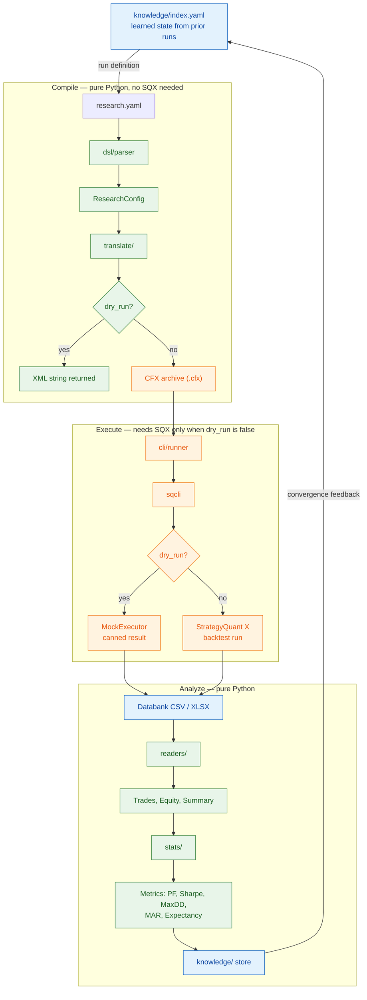

# QuantLab AI

**Quantitative Research SDK for Algorithmic Trading**

QuantLab AI is a Python SDK that bridges quantitative research with the StrategyQuant X (SQX) trading platform. Define strategies in a YAML DSL, translate them to SQX `.cfx` format, run backtests via SQX CLI, parse results, compute statistics, and manage research artifacts — all from Python.

## Architecture

The SDK is a library, not a service. It reads a YAML research definition,
compiles it into a StrategyQuant X project, optionally runs that project, and
folds the measured result back into the Knowledge Lake so the next run starts
from what was learned. Every stage has a `dry_run` path, so the whole loop is
runnable — and testable — without StrategyQuant X installed.



**Reading it:** green stages never touch SQX. Orange stages do. The
`dry_run?` diamonds are the same switch in both halves — set it and the loop
closes entirely in Python, which is why the test suite never needs a StrategyQuant
install.

Three independent build units live in this repository:

| Unit | Stack | Purpose |
|------|-------|---------|
| `sdk/` | Python 3.11+ | The research SDK described above, plus the 14-phase campaign engine |
| `installer/` | Go 1.23 | Terminal installer/wizard for setting up a machine |
| `app_movil/` | Kotlin + Jetpack Compose | Android companion app for monitoring campaigns |

## Installation

> **Moving to a new machine?** Follow **[docs/HANDOFF.md](docs/HANDOFF.md)** —
> it is the complete, ordered procedure for cloning, installing, configuring,
> and verifying this project from scratch.

### One-command install (recommended)

**Guided (TUI).** Prepares the machine and drops you into the installation
wizard, then the onboarding guide. Manual or autonomous — the TUI walks you
through API key, model, SDK path, StrategyQuant X path, and verification:

```bash
bash -c "$(curl -fsSL https://raw.githubusercontent.com/andrikonbeat/quantlabai/main/install.sh)"
```

> Why not `curl ... | bash`? A pipe steals stdin, so the TUI has no keyboard
> and skips itself. `bash -c "$(curl ...)"` keeps your terminal attached, so
> the wizard can open. If you must pipe, the script reattaches `/dev/tty`
> when available, otherwise it continues autonomously and tells you how to
> reopen the guide with `./installer/build/quantlab onboarding`.

**Autonomous (no TUI).** For CI or unattended installs — same preparation,
skipped wizards, tests still run unless `--skip-tests`:

```bash
curl -sSL https://raw.githubusercontent.com/andrikonbeat/quantlabai/main/install.sh | bash -s -- --no-wizard
```

What the one-liner does, in order: checks Python >= 3.11 / git (Go >= 1.23
optional) → clones or reuses the checkout → creates `./.venv` and installs
`sdk[dev]` → builds `installer/build/quantlab` when Go exists → runs
`quantlab install` (config wizard + SDK in `~/.quantlab/venv` + OpenCode
agents/skills/prompts + `~/.quantlab/state.json` with rollback) → runs
`quantlab onboarding` when interactive → syncs repo prompts/skills to
`~/.config/opencode/` (repo-wins) → verifies with `SQX_FORCE_MOCK=1 pytest`.

Flags: `--no-wizard` / `--yes` (skip TUIs), `--onboarding` / `--no-onboarding`
(force or skip the guide), `--skip-tests`, `--dev`, `--no-mock`.

### Prerequisites

- **Python 3.11+** (CI pins 3.11; the project is developed and verified on 3.14)
- **pip 26+** on Python 3.14 — `python -m pip install -U pip` if resolution fails
- **Git**
- Optional: StrategyQuant X (only for real backtests — see below)
- Optional: Go 1.23+ (only to build `installer/`), Android SDK + JDK (only for `app_movil/`)

### Setup

The Python package lives in `sdk/`, but the **virtualenv belongs at the repository
root**, because `pytest.ini` and `conftest.py` — which define the canonical test
suite — are root-level. Install in editable mode from the root:

```bash
git clone git@github.com:andrikonbeat/quantlabai.git
cd quantlabai

python3 -m venv .venv
source .venv/bin/activate          # Windows: .venv\Scripts\activate
python -m pip install -U pip

pip install -e "sdk[dev]"          # 'dev' adds pytest, ruff, mypy, pytest-asyncio
```

Verify the install before anything else:

```bash
SQX_FORCE_MOCK=1 python3 -m pytest -q
```

`SQX_FORCE_MOCK=1` is **mandatory**. Without it the suite tries to bind the real
StrategyQuant X daemon on port 5050 and hangs or fails.

> There is no committed Python lockfile, so `pip install -e "sdk[dev]"`
> resolves the declared ranges in `sdk/pyproject.toml`. If a test fails with
> `ModuleNotFoundError` for a declared dependency, your environment predates a
> dependency addition — re-run the install command above.

### StrategyQuant X (required for real backtests)

The SDK runs fully in dry-run/mock mode without SQX, but real dispatch,
backtests, retests, and optimization need a StrategyQuant X distribution.
QuantLab discovers it through `SQX_INSTALL_PATH` (falling back to
`--sqx-path` / `SQX_PATH`). Point it at your own install:

```bash
export SQX_INSTALL_PATH="/path/to/your/SQX_install_root"
export SQX_PORT=5050
```

`sqcli` lives at `$SQX_INSTALL_PATH/sqcli`; the bundled JDK is at
`$SQX_INSTALL_PATH/j64`. Set these in `.env` (copy `.env.example` and edit) or
your shell profile. Without a valid install, keep `SQX_FORCE_MOCK=1` for tests
and dry runs.

> **Repo layout note (HGN-02):** the StrategyQuant distribution is a
> machine-local tool dependency and is **never committed**. `.gitignore` excludes
> `assets/SQX_*`. Anything under `assets/` in your working copy is local-only and
> will not survive a fresh clone — do not treat it as project content.

## Quick Start

### 1. Create a Research Campaign

```yaml
# my_campaign.yaml
campaign: "My First Campaign"
market: EURUSD
timeframe: H1

building_blocks:
  - name: trend_follow
    indicator:
      name: EMA
      params:
        period: 200
    entry:
      description: "Price closes above EMA"
      conditions:
        - "close > ema_200"
    exit:
      description: "Price closes below EMA"
      conditions:
        - "close < ema_200"

strategies:
  - name: TrendFollow_v1
    direction: LONG
    building_blocks:
      - trend_follow

criteria:
  - metric: profit_factor
    operator: ">="
    value: 1.5
  - metric: sharpe
    operator: ">="
    value: 1.0
```

### 2. Parse the Campaign

```python
from quantlab.dsl.parser import parse_yaml

config = parse_yaml("my_campaign.yaml")
print(f"Campaign: {config.campaign}")
print(f"Market: {config.market.value}, Timeframe: {config.timeframe.value}")
```

### 3. Translate to CFX (Dry-Run)

```python
from quantlab.translate.cfx import CfxArchive

# Dry-run: returns XML without writing a .cfx file
result = CfxArchive.from_model(config, dry_run=True)
print(result.xml_content[:500])
```

### 4. Run via CLI (Dry-Run without SQX)

```python
from quantlab.cli.runner import CliRunner

runner = CliRunner(dry_run=True)
cli_result = runner.execute("backtest --cfx my_campaign.cfx")
print(cli_result.stdout)
```

### 5. Read Backtest Results

```python
from quantlab.readers.databank import DatabankCSVReader

reader = DatabankCSVReader()
trades = reader.read_trades("results/trades.csv")
equity = reader.read_equity("results/equity.csv")
summary = reader.read_summary("results/summary.csv")

print(f"Total trades: {len(trades)}")
print(f"Net profit: {summary.net_profit}")
print(f"Win rate: {summary.win_rate}")
```

### 6. Compute Statistics

```python
from quantlab.stats.engine import StatisticsEngine

engine = StatisticsEngine()
result = engine.compute_all(trades=trades, equity=equity, returns=[t.profit for t in trades])

print(f"Profit Factor: {result.profit_factor:.2f}")
print(f"Sharpe Ratio: {result.sharpe_ratio:.2f}")
print(f"Max Drawdown: {result.max_drawdown:.2f}%")
print(f"Expectancy: {result.expectancy:.2f}")
```

### 7. Use the Knowledge Lake

```python
from quantlab.knowledge.store import KnowledgeStore

store = KnowledgeStore(root="knowledge")
store.initialize()  # Creates 11 subdirectories with .gitkeep
store.rebuild_index()  # Scans all files and writes index.yaml
warnings = store.validate_formats()  # Checks for non-standard formats
```

## Orchestrated Campaign Flow

The AI-directed orchestrated campaign runs the full 14-phase research loop
end-to-end with human-validated gates at every boundary. The flow proceeds
through deploy, demo, and archive to the terminal live-ops phase (Guardian
watching the demo account) — it does NOT stop at optimize.

### Routing

`quantlab-orchestrator` classifies the intent and delegates campaign requests
(e.g., "run a full campaign") to the `quantlab-campaign` subagent via the
`task` tool. SDD, CLI, and dashboard routes are unchanged.

### Harness

The `quantlab-campaign` subagent owns the 14-phase loop:

```
research → hypothesis → config → review → dispatch → monitor → retest → optimize → portfolio → compile → deploy → demo → archive → live-ops
```

Each phase returns the Result Contract envelope (`status`,
`executive_summary`, `artifacts`, `next_recommended`, `risks`). A failed phase
halts the loop for a human decision.

> **Migration note (REQ-817)**: the legacy root script `_run_campaign.py`
> (which built the non-orchestrated pipeline) is retired. The single campaign
> entry point is the CLI `campaign run-flow`
> (`python3 -m quantlab.cli campaign run-flow --json`), which runs the full
> 14-phase orchestrated flow. Any harness or doc referencing `_run_campaign.py`
> SHALL point to `campaign run-flow` instead. Per-phase execution inside the
> orchestrated loop is bridged by
> `python3 sdk/quantlab/campaign/phase_runner.py --phase <name> --directive '<json>'`
> (REQ-818).

Assets are versioned in-repo:

- `ai/opencode/agents/campaign.md` — the campaign agent prompt
- `ai/opencode/skills/quantlab-run-campaign/SKILL.md` — the seed skill

### Human Gates (fail-closed)

Gates resolve through a decision-file channel under
`/tmp/sqx-gates/{campaign_id}/`: the pipeline writes a `.pending.json`
envelope, the agent presents it via the `question` tool, and the human
decision is written back as `.decision.json`. In headless mode the agent falls
back to stdin.

Autonomous rules are binding:

- The `HUMAN_APPROVE_CONFIG`, `HUMAN_APPROVE_DEPLOY`, `HUMAN_APPROVE_DEMO`,
  and `HUMAN_APPROVE_ARCHIVE` gates **always block** for a human decision
  (D2/REQ-38); a MODIFY verdict requires human confirmation before applying
  (D3).
- Unanswered gates **fail closed (HOLD)** — they never auto-approve (REQ-11).
- Legacy CLI auto-approve remains available outside orchestrated mode.

### Data

`DataManager` is **Dukascopy-only** at launch (FX M1/M5/H1). Orchestrated
dispatch runs `_ensure_data` as a hard pre-flight; crypto, CSV, and yahoo
datasources raise `NotSupportedError` (D5).

## Directory Structure

```
quantlab-ai/
├── README.md
├── LICENSE
├── SECURITY.md
├── AGENTS.md
├── pytest.ini            # pytest configuration (asyncio_mode=auto)
├── conftest.py           # Root test fixtures
├── opencode.json         # OpenCode agent/orchestrator config
├── docker-compose.yml    # API, SQX daemon, Postgres, Redis
├── Dockerfile
├── sdk/
│   ├── pyproject.toml
│   └── quantlab/
│       ├── __init__.py       # Package root + version
│       ├── versioning.py     # Semantic version + compatibility
│       ├── dsl/              # YAML DSL — models + parser
│       ├── translate/        # Model → CFX XML → ZIP
│       ├── cli/              # SQX CLI wrapper (executor protocol)
│       ├── readers/          # Databank CSV/XLSX result readers
│       ├── stats/            # Trading metrics computation
│       ├── knowledge/        # Knowledge Lake management
│       ├── data/             # Market data providers (Dukascopy-only)
│       ├── agents/           # Multi-agent research pipeline agents
│       ├── tools/            # Platform, errors, utilities
│       └── …                 # 20 more: campaign, gates, guardian, evolution,
│                                 # pipeline, mcp, reporting, robustness, dashboard,
│                                 # cfx, compiler, analysis, sqx, substrate, costs,
│                                 # broker, health, jforex, phase4, customproject
│                                 # Full index in docs/index.md
├── tests/                # Root test suite (per-area subpackages)
├── sdk/tests/            # SDK test suite
├── app_movil/            # Android companion app (Kotlin, Jetpack Compose)
├── ai/opencode/          # Agent prompts, skills, and orchestrator config
├── installer/            # Go installer + release tooling
├── examples/             # Sample pipeline.yaml / research-config.yaml
├── docs/                 # PRD, STATE, changelog, reference guides
│   └── sqx-builder-config/ # SQX Builder config (KB seed source)
├── infra/                # Infrastructure assets (DB init schema)
├── knowledge/            # Knowledge Lake (data)
│   ├── index.yaml
│   ├── raw/ structured/ graph/ embeddings/ datasets/
│   └── pipeline-runs/ agent-memory/ campaign-phases/ …
├── sdd/                  # SDD artifacts: PROJECT_STATE.md, changes/, specs/, config.yaml
├── pipelines/            # Pipeline YAML definitions
├── strategies/
│   └── HelloWorldStrategy.java # JForex 4 strategy template
├── deploy/               # Generated deployment bundles (git-ignored)
├── reports/              # Generated campaign reports (git-ignored)
└── _output/              # Generated campaign artifacts (git-ignored)
```

> The `assets/` directory holds the local StrategyQuant X distribution and is
> git-ignored — it is not part of the public repository.

## Companion Mobile App

`app_movil/` contains an Android companion app (Kotlin + Jetpack Compose) for
monitoring campaigns. It is versioned in this repository but is a separate
build unit from the Python SDK (see `app_movil/quantlabai/` for its Gradle
project).

## Commands

### Testing

Run from the **repository root** — `pytest.ini` collects both `tests/` and
`sdk/tests/`:

```bash
SQX_FORCE_MOCK=1 python3 -m pytest -q              # full suite (~5 min)
SQX_FORCE_MOCK=1 python3 -m pytest -q tests/campaign/   # one area
SQX_FORCE_MOCK=1 python3 -m pytest -q -k test_name      # filter by name
```

### Linting and type checks

Same environment, from `sdk/` (this is what CI runs):

```bash
cd sdk
python -m ruff check .
python -m ruff format --check .
python -m mypy quantlab --strict
```

### Go installer

```bash
cd installer
go build ./...
go test -short ./...
```

### Dry-Run Walkthrough (No SQX Required)

The entire pipeline works without StrategyQuant X installed:

1. **DSL → Config**: `parse_yaml("campaign.yaml")` — pure Python YAML parsing
2. **Config → XML**: `CfxArchive.from_model(config, dry_run=True)` — generates XML, skips ZIP
3. **CLI mock**: `CliRunner(dry_run=True)` — uses `MockExecutor`, no subprocess
4. **Readers**: Works on **any** CSV/XLSX file — no SQX dependency
5. **Statistics**: Pure Python math — works on any trade list
6. **Knowledge Lake**: Filesystem operations — no external services

## SDK Modules

| Module | Purpose | SQX Required |
|--------|---------|-------------|
| `quantlab.dsl` | YAML-based research DSL parser | No |
| `quantlab.translate` | Model-to-CFX XML translation | No |
| `quantlab.cli` | SQX CLI wrapper (Executor protocol) | Yes (real mode) |
| `quantlab.readers` | Databank CSV/XLSX result parsing | No |
| `quantlab.stats` | Trading performance metrics | No |
| `quantlab.knowledge` | Knowledge Lake management | No |

## Pipeline Commands

Manage pipeline YAML files and execute campaigns.

| Command | Description |
|---------|-------------|
| `quantlab pipeline list` | List available pipelines |
| `quantlab pipeline run <name>` | Run pipeline (dry-run by default) |
| `quantlab pipeline run <name> --dry-run=false` | Execute real SQX pipeline stages |
| `quantlab pipeline run <name> --params key=value` | Override pipeline parameters |
| `quantlab pipeline history` | Show pipeline run history |
| `quantlab pipeline validate <file>` | Validate pipeline YAML syntax |
| `quantlab pipeline config <name>` | Show pipeline configuration |

See [Pipeline YAML Reference](docs/configuration/pipeline-yaml.md) for complete YAML schema, stage types, and examples.

## Report Commands

Generate campaign reports with themes, benchmarks, and custom templates.

```bash
# Install reporting extras
pip install quantlab[reporting]           # Plotly-based (default)
pip install quantlab[reporting-matplotlib]  # Matplotlib fallback
```

| Command | Description |
|---------|-------------|
| `quantlab report generate <campaign>` | Generate HTML + JSON report |
| `quantlab report generate <campaign> --theme dark` | Dark theme |
| `quantlab report generate <campaign> --theme light` | Light theme |
| `quantlab report generate <campaign> --benchmark bench.csv` | Overlay benchmark equity curve |
| `quantlab report generate <campaign> --template custom.j2` | Use custom Jinja2 template |
| `quantlab report generate <campaign> --output-dir ./reports` | Custom output directory |
| `quantlab report generate <campaign> --json` | JSON-only output |

**Benchmark CSV format:**
```csv
timestamp,equity
2024-01-01 00:00:00,10000
2024-01-02 00:00:00,10100
```

See [Reporting Reference](docs/guides/reporting.md) for template variables, themes, API, and exit codes.

## Knowledge Commands

Query, tag, link, and export campaigns from the Knowledge Lake.

| Command | Description |
|---------|-------------|
| `quantlab knowledge query [--sharpe ">1.5"] [--pf ">1.2"] [--tags trend]` | Filter campaigns by metrics/tags |
| `quantlab knowledge query --json` | JSON output |
| `quantlab knowledge tag <campaign> <tags...>` | Add tags |
| `quantlab knowledge tag <campaign> <tag> --remove` | Remove tags |
| `quantlab knowledge link --parent <id> --children <id1> <id2>` | Create parent-child links |
| `quantlab knowledge link --list <campaign>` | List links |
| `quantlab knowledge export --format csv|json --output file.csv` | Export query results |
| `quantlab knowledge rebuild-index` | Rebuild knowledge index |
| `quantlab sqx kb seed-ohlc [--symbols EURUSD] [--timeframes M1,M5,H1]` | Seed OHLC market data into Knowledge Lake (requires JForex4 history) |

### Builder / CFX Flags

| Variable | Default | Effect |
|----------|---------|--------|
| `QUANTLAB_CUSTOM_PROJECT` | `1` (CustomProject) | `0` → legacy `.cfx` (schema 141.2219); `1` → `CustomProject` `.cfx` (schema 144.2953, per-task XML) |

See [Knowledge Query Reference](docs/guides/knowledge-query.md) for filter syntax, API, and schema details.

## Documentation

**[docs/index.md](docs/index.md)** is the index of every document in `docs/`,
grouped by directory. New to the project, start with
[Running Multi-Agent Campaigns](docs/guides/running-campaigns.md).

## License

MIT — see [LICENSE](LICENSE).

## Security

Report vulnerabilities privately via GitHub Private vulnerability reporting —
see [SECURITY.md](SECURITY.md) for the policy and response expectations.
